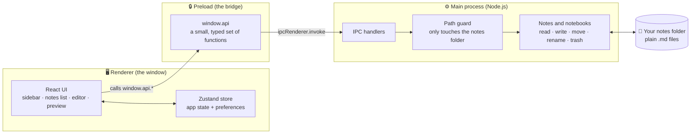

<div align="center">


# Luna MD

**A free, local-first Markdown notes app for the desktop, with a real Vim mode.**

Your notes are plain `.md` files in a folder you own. No account, no cloud, no subscription.


</div>

<!-- Add a screenshot: save one as docs/screenshot.png and uncomment the line below -->
<!--  -->

---

## 👋 A quick, honest note before you read on

**Luna MD is about 80% vibe coded.** It's my first real attempt at building most of a project together with AI. I described what I wanted, read and tested what came back, pushed back when it was wrong, and steered the design and the details myself, but a large share of the code was written by AI.

I learned a *lot* doing it: how Electron splits work between the main process and the window, how IPC and preload scripts keep things safe, how CodeMirror works under the hood, how to manage state in React, and how much of building software is really about asking the right questions. I also know I still have a long way to go, and you'll probably find rough edges in the code. That's part of the journey.

**Why build it?** I just wanted my own text editor: one that looks the way I like, works the way I think, keeps my notes as normal files, and is **free**. So I made one.

---

## ✨ Features

### Writing
- **Fast Markdown editor** built on [CodeMirror 6](https://codemirror.net/), with Markdown syntax highlighting (including highlighted code blocks for many languages)
- **Three views:** Editor, Split (editor + live preview side by side), and Preview
- **Live preview** with GitHub-flavored Markdown: tables, task lists, strikethrough, autolinks
- **Jump to section:** a searchable outline of the note's headings in the preview (`⌘⇧O`)
- **Autosave:** changes are saved shortly after you stop typing, written atomically so a crash can't leave a half-written file
- **Images:** paste a screenshot or drag a picture into a note. It's saved next to the note and shows up in the preview
- **Export to PDF or HTML:** a clean, standalone file with images embedded
- **Built-in Markdown reference** (`⌘/`) for when you forget the syntax
- Spell check, line wrapping, line numbers and **relative line numbers**

### Vim mode
- Full Vim emulation: modes, motions, text objects, operators, registers, `.` repeat, counts, `/` search, `:` commands
- **Your own keymaps**, written in Neovim Lua *or* Vimscript, right in the settings (see **Vim mode** below)
- A proper `<leader>` key that waits for the rest of your mapping, like real Vim
- App commands such as `:w`, `:q`, `:Ex`, `:Split`, `:Preview`

### Organizing
- **Notebooks** are just folders; **notes** are just `.md` files
- **Nested notebooks:** notebooks inside notebooks, as deep as you like. Drag one notebook onto another to nest it
- **Back and forward** through the notes you've opened, like a browser (`⌘[` / `⌘]` or the mouse side buttons)
- **Tags** from front matter, listed in the sidebar, with `#tag` filtering
- **Favorites** for the notes you keep coming back to
- **Search everything** with `⌘K`: notebooks, note names and note contents
- Drag notes between notebooks, rename inline, move items to the system Trash (recoverable)
- **Import** existing `.md`, `.markdown` and `.txt` files

### Look and feel
- Light, dark, or follow the system
- Choose the editor font (mono, sans, serif) and size, and the preview width
- Native macOS styling: inset traffic lights, translucent sidebar
- Collapsible, resizable sidebar and notes list

---

## 🧠 How it works

### Your notes are just files

Everything lives in one folder on your computer. By default that's **`~/Documents/LunaMD`**, and you can pick a different folder in **Settings → Notes**.

```
~/Documents/LunaMD/
├── Personal/                  ← a notebook (a folder)
│   ├── Ideas.md               ← a note (a Markdown file)
│   └── Journal/               ← a notebook inside a notebook
│       └── November.md
└── Work/
    ├── Meeting notes.md
    └── _attachments/          ← images pasted into Work's notes
        └── whiteboard.png
```

Because they're ordinary files, you can open them in any other editor, sync them with iCloud, Dropbox or Git, back them up, or walk away from Luna MD whenever you like. Nothing is locked in.

### Tags live inside the note

Tags come from a front matter block at the top of a note. Any of these forms work:

```markdown
---
tags: [work, ideas]
---

# My note
```

```yaml
tags: work, ideas
# or
tags:
  - work
  - ideas
```

Tags are normalized, so `#Work`, `work` and `" work "` are all the same tag, and spaces become dashes (`To Do` → `to-do`). The editor puts your cursor just *below* the front matter when you open a note, and the preview hides it.

### Images live next to your notes

When you paste or drop an image into the editor, Luna MD saves it in an `_attachments` folder inside that notebook and inserts a normal Markdown image link:

```markdown

```

So the images stay with your notes, and other Markdown apps can show them too. The `_attachments` folder never shows up as a notebook. If you move a note to another notebook, its images are copied along with it so the links keep working.

The preview loads these images through a small custom protocol (`luna-file://`) that only serves files from inside your notes folder.

### Exporting

**Export as PDF** or **HTML** from the toolbar's share button, a note's right-click menu, or the Vim commands `:ExportPdf` / `:ExportHtml`. The note is rendered exactly like the preview, wrapped in its own clean stylesheet, and images are embedded, so the file stands on its own. PDFs are printed by a hidden window that runs no scripts.

### The architecture

Luna MD is an [Electron](https://www.electronjs.org/) app, so it's split into three parts that talk to each other:



- **Main process** (`src/main`): the Node.js side. It's the only part allowed to touch the file system. It lists notebooks, reads and writes notes, parses tags, handles favorites, shows right-click menus, and moves things to the Trash.
- **Preload** (`src/preload`): a thin bridge that exposes a small, typed `window.api` to the window through Electron's `contextBridge`. The UI never gets raw Node.js access.
- **Renderer** (`src/renderer`): the React app you see. It asks the main process for data through `window.api` and renders everything.

**Safety:** every path the window sends to the main process is checked against the notes folder (`inRoot`), so the UI can't read or write files outside it. Links in your notes open in your normal browser instead of inside the app. Writes go through `write-file-atomic`, so a crash mid-save can't corrupt a note.

### What happens when you type

1. CodeMirror reports the change to the editor page.
2. The page waits until you pause (the delay is set in **Settings → Editor → Save changes**: quickly, normal or relaxed).
3. It calls `window.api.aegis.writeNote(path, text)`.
4. The main process checks the path and writes the file atomically.
5. The notes list refreshes, so previews, dates and tags stay current.

Unsaved changes are also flushed when you switch notes or close the window. If a note is moved to the Trash, pending edits are thrown away so the save can't bring the file back.

### Where settings are kept

| What | Where |
|---|---|
| Your notes | Your notes folder (`~/Documents/LunaMD` by default) |
| Favorites | `favorites.json` in the app's data folder |
| Notes folder location | `settings.json` in the app's data folder |
| Preferences (theme, fonts, Vim keymaps…) | The app's local storage |

> **Fun fact:** in the code, a notebook is called an **"Aegis"**. That's why you'll see `AegisViewer`, `getAegisRoot` and `window.api.aegis` throughout. It was the working name, and it stuck.

---

## ⌨️ Vim mode

Turn it on or off in **Settings → Editor → Vim mode**. Once it's on, a **Vim keymaps** box appears where you can write your own mappings. You can write them in Neovim Lua or Vimscript and mix both:

```lua
-- Neovim-style Lua
vim.g.mapleader = " "

vim.keymap.set("n", "<leader>pv", vim.cmd.Ex)              -- open the note finder
vim.keymap.set("n", "<leader>w", "<cmd>w<CR>")             -- save now
vim.keymap.set({ "n", "v" }, "<leader>y", '"+y')           -- yank to the system clipboard
vim.keymap.set("n", "<leader>rn", "<cmd>set rnu!<CR>")     -- toggle relative numbers

vim.opt.number = true
vim.opt.relativenumber = true
```

```vim
" Vimscript works too
let mapleader = ","
inoremap jk <Esc>
nnoremap <leader>q :q<CR>
set nu rnu
```

Changes apply as you type. If a line can't be used, the box tells you which line and why.

**Supported:**
- `vim.keymap.set` / `vim.keymap.del` in modes `n`, `i`, `v`, `x` and `o`, with `{ remap = true }`
- `map`, `noremap`, `nmap`, `nnoremap`, `imap`, `inoremap`, `vmap`, `xmap` and their `unmap` forms
- Right-hand sides: plain keys, `:commands<CR>`, `<cmd>…<CR>`, `vim.cmd.X`, `vim.cmd("X")`, `function() vim.cmd("X") end`, `<Nop>`
- `vim.g.mapleader` / `let mapleader`, including a Space leader
- `number` and `relativenumber` (as `vim.opt.*`, `set …` or `:set …` while editing)

**Not supported:** arbitrary Lua (such as `print()` or plugins), most other `vim.opt` options, and command-line or terminal mode mappings.

### App commands

| Command | What it does |
|---|---|
| `:w` | Save now |
| `:q` | Close the note |
| `:wq` / `:x` | Save and close |
| `:Ex` / `:Explore` | Open the note finder (the closest thing to netrw) |
| `:Sidebar` | Show or hide the sidebar |
| `:Editor` · `:Split` · `:Preview` | Switch the view |
| `:Favorite` | Favorite or unfavorite the current note |
| `:Settings` | Open settings |
| `:ExportPdf` · `:ExportHtml` | Export the current note |
| `:set nu` · `:set rnu` · `:set rnu!` | Line numbers / relative numbers / toggle |

---

## ⌨️ Keyboard shortcuts

| Shortcut | Action |
|---|---|
| `⌘K` | Search notebooks and notes |
| `⌘[` · `⌘]` | Back · forward |
| `⌘1` · `⌘2` · `⌘3` | Editor · Split · Preview |
| `⌘⇧O` | Jump to a section (in the preview) |
| `⌘/` | Markdown reference |
| `⌘,` | Settings |
| `Tab` / `⇧Tab` | Indent / outdent in the editor |
| `Esc` | Close any window or popup |

On Windows and Linux, use `Ctrl` in place of `⌘`.

---

## 📥 Install

Paste one line into a terminal. The script downloads the latest release from this repo's [Releases page](https://github.com/DortaEdward/md-luna/releases), **checks it against the release's SHA-256 checksums**, and installs it. There's no installer to double-click, and nothing comes from anywhere but GitHub. Read [`install.sh`](https://github.com/DortaEdward/md-luna/blob/main/install.sh) or [`install.ps1`](https://github.com/DortaEdward/md-luna/blob/main/install.ps1) first if you like; they're short.

**macOS and Linux**

```bash
curl -fsSL https://raw.githubusercontent.com/DortaEdward/md-luna/main/install.sh | bash
```

**Windows** (PowerShell)

```powershell
irm https://raw.githubusercontent.com/DortaEdward/md-luna/main/install.ps1 | iex
```

Run the same line again any time to **update**.

| | Where it goes | How to remove it |
|---|---|---|
| macOS | `/Applications/Luna MD.app` | `curl -fsSL …/install.sh \| bash -s -- --uninstall` |
| Linux | `~/.local/share/luna-md`, plus an app-menu entry and a `luna-md` command | `curl -fsSL …/install.sh \| bash -s -- --uninstall` |
| Windows | `%LOCALAPPDATA%\Programs\Luna MD`, plus a Start menu shortcut (no admin rights needed) | **Settings → Apps**, or run the script with `-Uninstall` |

Uninstalling never touches your notes.

<details>
<summary>More options</summary>

- **A specific version:** `curl -fsSL …/install.sh | bash -s -- --version v0.1.0` (or `-Version v0.1.0` on Windows)
- **Download by hand:** every release also has a `.dmg` (Mac), `.zip`, `.AppImage` and `.deb` on the [Releases page](https://github.com/DortaEdward/md-luna/releases), along with `SHA256SUMS.txt` to check them against.
- **Linux:** AppImages need FUSE 2 on some distros (`sudo apt install libfuse2`).
- **Unsigned Mac builds:** until the app is signed with an Apple Developer certificate ([docs/CODE_SIGNING.md](docs/CODE_SIGNING.md)), the install script signs it locally for your Mac so it opens normally. A `.dmg` downloaded in a browser will need right-click → **Open** the first time.

</details>

## 🚀 Getting started (for developers)

### Requirements
- [Node.js](https://nodejs.org/) 22 or newer
- npm (comes with Node)

### Run it

```bash
git clone https://github.com/DortaEdward/md-luna.git
cd md-luna
npm install
npm run dev
```

### Build the app

```bash
npm run build:mac     # macOS (.dmg and .zip, Apple Silicon and Intel)
npm run build:win     # Windows (.zip)
npm run build:linux   # Linux (.AppImage and .deb)
```

Builds land in the `dist/` folder.

> **macOS note:** builds are signed and notarized when Apple Developer credentials are set up (see [docs/CODE_SIGNING.md](docs/CODE_SIGNING.md)). Without them the app is unsigned, so the first time you open it, right-click it and choose **Open** (or allow it in **System Settings → Privacy & Security**).

### Releases

To publish a release, bump the version and push the tag:

```bash
npm version patch          # e.g. 0.1.0 → 0.1.1, creates the tag v0.1.1
git push --follow-tags
```

[GitHub Actions](.github/workflows/release.yml) then builds Luna MD on macOS, Windows and Linux (x64 and arm64), writes a `SHA256SUMS.txt`, and publishes everything as a GitHub release, which is where the install scripts get it from. The files always have the same names (like `Luna-MD-mac-arm64.zip`), so "latest release" links never go stale.

The Mac app is signed and notarized automatically once the Apple secrets are added; see [docs/CODE_SIGNING.md](docs/CODE_SIGNING.md). Locally, `npm run release:mac` does the same for a Mac build.

> Luna MD is designed and used on **macOS**. Windows and Linux builds should work, but they're less tested.

### Other scripts

| Command | What it does |
|---|---|
| `npm run typecheck` | Type-check the main and renderer code |
| `npm run lint` | Run ESLint |
| `npm run format` | Format everything with Prettier |

---

## 🧰 Tech stack

| Area | Tools |
|---|---|
| Desktop shell | [Electron](https://www.electronjs.org/) and [electron-vite](https://electron-vite.org/) |
| UI | [React](https://react.dev/), [React Router](https://reactrouter.com/), [Tailwind CSS](https://tailwindcss.com/) with Typography, [Lucide](https://lucide.dev/) icons |
| Editor | [CodeMirror 6](https://codemirror.net/) and [@replit/codemirror-vim](https://github.com/replit/codemirror-vim) |
| Markdown preview | [react-markdown](https://github.com/remarkjs/react-markdown), `remark-gfm`, `remark-breaks` |
| State | [Zustand](https://zustand-demo.pmnd.rs/) (preferences persisted locally) |
| Files | Node `fs`, `write-file-atomic` |
| Language | TypeScript throughout |

## 📂 Project structure

```
src/
├── main/                   # Electron main process (Node.js)
│   ├── index.ts            #   creates the window
│   ├── ipc/                #   handlers the window can call, right-click menus
│   ├── Aegis/              #   notebooks and notes: files, tags, favorites, images, export, settings
│   └── db/                 #   SQLite schema (planned, see roadmap)
├── preload/                # the safe bridge: exposes window.api
├── renderer/src/           # the React app
│   ├── components/         #   Sidebar, AegisViewer (notes list), TextEditor, MdViewer, Settings…
│   ├── pages/Home/         #   the editor/preview page
│   ├── lib/                #   Vim config parser, line numbers, export, path helpers
│   └── stores/             #   Zustand state, back/forward history
└── shared/                 # types and helpers shared by main and renderer
docs/CODE_SIGNING.md        # how to sign and notarize the Mac app
.github/workflows/          # builds and publishes releases when you push a version tag
install.sh / install.ps1    # the one-line installers (download + verify + install)
```

---

## 🗺️ Roadmap and known gaps

This is a personal project and a learning project, so it's not finished. Things I'd like to do or fix:

- [ ] **Full-text search index:** a SQLite schema with full-text search tables is already in `drizzle/`, but it isn't connected yet. Search currently matches note names and previews.
- [ ] **Watch the notes folder** so changes made in other apps show up immediately (right now the app refreshes when it makes changes itself)
- [x] Make the back/forward buttons in the toolbar work
- [x] Nested notebooks (folders inside folders)
- [x] Images in notes (paste or drag in)
- [x] Export to PDF / HTML
- [x] Code signing setup for macOS builds (needs an Apple Developer account to switch on)
- [ ] Clean up lint warnings and leftover code from the vibe-coding process
- [ ] Windows code signing

Ideas, bug reports and pull requests are welcome. Just remember this is a hobby project made by someone still learning. 🙂

---

## 🙏 Thanks

- The [CodeMirror](https://codemirror.net/) and [codemirror-vim](https://github.com/replit/codemirror-vim) projects, which do the heavy lifting in the editor
- [electron-vite](https://electron-vite.org/) for the project template
- The AI that wrote most of this code with me, and taught me a lot along the way

## 📄 License

Luna MD is free to use. A formal open-source license is coming soon.

---

<div align="center">

Made by **Edward Dorta**, with a lot of help from AI ✨

</div>
